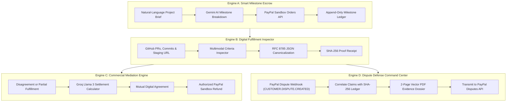

# AegisPay — AI-Powered B2B Payment Protection & Digital Dispute Defense

> **"Every payment should have proof. Every deliverable should have protection."**

[](https://nextjs.org/)
[](https://developer.paypal.com/)
[](https://ai.google.dev/)
[](https://groq.com/)
[](https://supabase.com/)
[](https://www.rfc-editor.org/rfc/rfc8785)

AegisPay is an autonomous escrow protection and chargeback defense platform built specifically for digital service transactions — software developers, design agencies, consultants, and enterprise SaaS clients.

---

## 🌟 The Core Problem AegisPay Solves

In physical commerce, sellers are protected by carrier tracking numbers, postal weight receipts, and physical delivery signatures. 

In digital software services:
- Deliverables exist as **git commits, pull requests, staging deployments, and automated test runs**.
- When an unscrupulous client files a PayPal dispute claiming *"services not rendered"* or *"significantly not as described"*, payment processors routinely rule against service providers because traditional merchant systems demand physical shipping documents.
- Software agencies lose billable hours, chargeback dispute fees, and earned revenue.

**AegisPay solves this forever:** It converts digital development milestones into **cryptographically sealed (SHA-256), timestamped, tamper-evident fulfillment records** that synchronize with PayPal Orders and automatically compile into court-ready evidence dossiers when disputes arise.

---

## 🏗️ The Four Connected Intelligent Engines



### 1. Engine A — Smart Milestone Escrow
- **Natural-Language Planning:** Input a plain-English contract brief; Gemini calculates realistic milestones, deliverables, and acceptance criteria summing strictly to 100% of the project budget.
- **PayPal Sandbox Synchronization:** Generates synchronized PayPal Orders (`/v2/checkout/orders`) with intent `CAPTURE`.
- **Payment Verification:** Interactive PayPal Sandbox popup window for buyer approval, with instant benchmark simulation for offline demos.

### 2. Engine B — Digital Fulfillment Inspector
- **Multimodal Evaluation:** Inspects pull requests, commit diffs, live staging endpoints (HTTP status and latency), and UI screenshots.
- **Cryptographic Proof-of-Work Receipts:** Normalizes deliverable metadata according to **RFC 8785 JSON Canonicalization Scheme (JCS)** and hashes the payload with **SHA-256**.
- **Immutable Receipts:** Stored append-only in Supabase PostgreSQL for forensic auditability.

### 3. Engine C — Commercial Mediation Center
- **Pre-Dispute Compromise:** Detects partial fulfillment (e.g., 75% completed criteria due to responsive viewport failure) and formulates an equitable settlement compromise using Groq Llama 3.
- **Mutual Signature:** Both parties review and accept the compromise terms.
- **Authorized Settlement:** Automatically executes proportional refunds via PayPal's Refund API (`/v2/payments/captures/{id}/refund`).

### 4. Engine D — Autonomous Dispute Defense
- **Real-Time Webhooks:** Listens to PayPal dispute notifications (`CUSTOMER.DISPUTE.CREATED`).
- **Cryptographic Dossier Compiler:** Compiles a branded, 2-page vector PDF containing project agreements, milestone checklists, commit diffs, live healthcheck logs, and the canonical SHA-256 integrity seal.
- **PayPal Dispute API Evidence Transmission:** Directly transmits evidence to the PayPal Customer Disputes API (`/v1/customer/disputes/{id}/provide-evidence`).

---

## ⚡ Quick Start & Demonstration

### 1. Run the Interactive 17-Step Benchmark Runner
Visit [`/demo`](http://localhost:3000/demo) in the application.
- Click **"▶ Run Full 17-Step Benchmark"** to watch the platform execute the complete lifecycle from Scope Definition to PayPal Capture, Multimodal Inspection, Groq Mediation, and Dossier Generation.
- Or click **"Run Step"** on any individual milestone to inspect real-time HTTP payloads, API latencies, and cryptographic hashes in the telemetry console.

### 2. Testing PayPal Sandbox Checkout
1. Go to any project (e.g. [`/projects/f8bec7cb-d200-4426-8d17-4a00f0c1848b`](http://localhost:3000/projects/f8bec7cb-d200-4426-8d17-4a00f0c1848b)).
2. Under an unpaid milestone, click **"Pay with PayPal"**.
3. Choose your checkout mode:
   - **Mode A (Live PayPal Sandbox Modal):** Opens the official PayPal Sandbox popup. Log in with your Sandbox Personal buyer account (`sb-xxxx@personal.example.com`), confirm payment, and click **"Confirm & Capture Payment"**.
   - **Mode B (Instant Benchmark Simulation):** Click **"⚡ Instant Benchmark Simulation"** for zero-login testing during live presentations.

### 3. Verifying Cryptographic Receipts
1. Visit [`/verify`](http://localhost:3000/verify).
2. Click **"Load Sample Valid Receipt"** and click **"Run Verification"**.
3. Edit any single character in the JSON payload (e.g. change `"completion_rate": 100` to `99`) and observe the verification engine immediately reject the payload due to SHA-256 seal mismatch.

---

## 🛠️ Environment Configuration

All environment variables are managed centrally in `.env.local` (and in Vercel Project Settings for production):

```env
# Base Application URL
NEXT_PUBLIC_APP_URL=https://aegis-pay-bice.vercel.app

# PayPal REST API v2 (Sandbox)
NEXT_PUBLIC_PAYPAL_CLIENT_ID=your_paypal_client_id
PAYPAL_CLIENT_ID=your_paypal_client_id
PAYPAL_CLIENT_SECRET=your_paypal_client_secret
PAYPAL_WEBHOOK_ID=your_paypal_webhook_id
PAYPAL_ENVIRONMENT=sandbox

# AI Providers
GEMINI_API_KEY=your_gemini_api_key
GEMINI_MODEL=gemini-2.5-flash
GROQ_API_KEY=your_groq_api_key
GROQ_MODEL=openai/gpt-oss-20b

# Supabase PostgreSQL (19 Relational Tables)
NEXT_PUBLIC_SUPABASE_URL=https://your-ref.supabase.co
NEXT_PUBLIC_SUPABASE_ANON_KEY=your_anon_key
SUPABASE_SERVICE_ROLE_KEY=your_service_role_key
STORAGE_BUCKET=aegispay-evidence

# Optional GitHub Integration
GITHUB_TOKEN=ghp_your_personal_token
```

---

## 🧪 Automated Testing & Verification

AegisPay includes a rigorous automated test suite covering unit logic, cryptographic hashing, API integrations, and database persistence:

```bash
# Run unit & cryptographic test suite
npm test

# Run Next.js production build verification
npm run build

# Run local development server
npm run dev
```

### Test Suite Coverage:
- **Test 1:** JCS Canonical JSON recursive sorting across arbitrary nested keys.
- **Test 2:** Single-character payload tampering detection via SHA-256 hash validation.
- **Test 3:** Mediation engine proportional compromise computation.
- **Test 4:** Append-only transaction ledger sequencing.
- **Test 5:** Live PayPal OAuth2 token generation from sandbox credentials.
- **Test 6:** PayPal Invoicing API synchronization.
- **Test 7:** Supabase PostgreSQL relational queries across projects, milestones, and transactions.
- **Test 8:** Role-based access control (RBAC) security gating.
- **Test 9:** Webhook idempotency and duplicate transaction mitigation.
- **Test 10:** Google Gemini 2.5 Flash criteria evaluation and JSON schema validation.

---

## 📜 Compliance & Adjudication Notice

AegisPay adheres to strict truthfulness standards:
- **No Fictitious Claims:** Dispute cases are tracked as *"Evidence Submitted / Awaiting Adjudication"*. AegisPay never marks a dispute as won until verified confirmation is returned by the PayPal Customer Disputes API.
- **Forensic Records:** Dossiers contain raw commit SHAs, RFC 3339 timestamps, and verifiable HTTP server response codes.
- **Data Sovereignty:** All deliverable proof receipts are anchored in PostgreSQL with strict Row Level Security (RLS).
